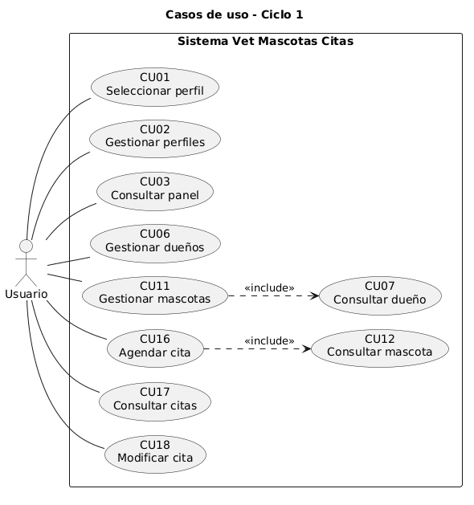
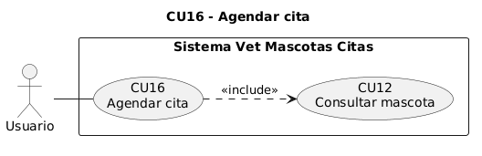

# 4. FT. CAPTURA DE REQUISITOS

## 4.1 Identificar Actores y Casos de Uso

### 4.1.1 Identificar Actores

Un **actor** es un rol externo que inicia objetivos de negocio. Las tablas, la API y los procesos internos del servidor no son actores. El personal de la clínica se modela como un actor **Usuario**, que elige un perfil de trabajo en la pantalla inicial; no existe actor separado por cada perfil porque no hay permisos diferenciados en servidor.

<!-- casos_uso:actores -->

### 4.1.2 Identificar Casos de Uso

<!-- casos_uso:listado -->

## 4.2 Priorizar Casos de Uso

<!-- casos_uso:priorizacion -->

**Distribución de complejidad (A=3, M=2, B=1)**

| Distribución | Ciclo 1 | Ciclo 2 |
| --- | --- | --- |
| Casos de uso | CU01–CU03, CU06–CU07, CU11–CU12, CU16–CU18 | CU04–CU05, CU08–CU10, CU13–CU15, CU19–CU20 |
| Paquetes activos | P1–P4 | P1–P4 |
| Puntos A/M/B | 3+2+1+2+2+2+1+3+1+2 = 19 | 1+1+1+2+2+2+1+1+2+2 = 15 |

La diferencia de puntos (4) se acepta porque el ciclo 1 concentra el núcleo operativo (agenda y maestros).

**Ciclo 1**

| ID | Caso de uso | Prioridad | Ciclo |
| --- | --- | --- | --- |
| CU01 | Seleccionar perfil | Crítica | C1 |
| CU02 | Gestionar perfiles | Importante | C1 |
| CU03 | Consultar panel principal | Media | C1 |
| CU06 | Gestionar dueños | Crítica | C1 |
| CU07 | Consultar dueño | Importante | C1 |
| CU11 | Gestionar mascotas | Crítica | C1 |
| CU12 | Consultar mascota | Importante | C1 |
| CU16 | Agendar cita | Crítica | C1 |
| CU17 | Consultar citas | Importante | C1 |
| CU18 | Modificar cita | Importante | C1 |

**Ciclo 2**

| ID | Caso de uso | Prioridad | Ciclo |
| --- | --- | --- | --- |
| CU04–CU05, CU08–CU10, CU13–CU15, CU19–CU20 | Ver catálogo completo | Variada | C2 |

## 4.3 Detallar Casos de Uso

### 4.3.1 Ciclo 1

#### CU01 Seleccionar perfil

<!-- ficha -->
|  | |
| --- | --- |
| Caso de uso | CU01: Seleccionar perfil |
| Propósito | Establecer el contexto de navegación según el rol de trabajo elegido. |
| Descripción | El usuario elige uno de los perfiles activos listados por la API; el identificador se guarda en almacenamiento local del navegador y se redirige al panel principal. |
| Actor(es) | Usuario |
| Actor iniciador | Usuario |
| Paquete y ciclo | P1 Gestión de configuración y acceso · Ciclo 1 |
| Relaciones | Ninguna relación «include» o «extend». |
| Precondición | • Existe al menos un perfil activo en base de datos (seed o CU02). |
| Flujo principal | 1. El usuario abre la aplicación. 2. El sistema solicita perfiles activos a `/api/perfiles?activo=true`. 3. El sistema muestra tarjetas por perfil. 4. El usuario selecciona un perfil. 5. El sistema guarda el perfil en el cliente y navega a «Dashboard». |
| Flujos alternativos | A1. Si ya hay perfil guardado, el layout puede redirigir desde la raíz al selector o al panel según implementación de `app/page.tsx`. |
| Postcondición | • El perfil seleccionado queda disponible para la sesión del navegador. |
| Excepciones | E1. Error de red: el sistema muestra «mensaje de error» en pantalla. |
| Clases de análisis previstas | Vista: Vperfil / Control: Cperfil / Entidad: Eperfil |

#### CU16 Agendar cita

<!-- ficha -->
|  | |
| --- | --- |
| Caso de uso | CU16: Agendar cita |
| Propósito | Persistir una nueva cita veterinaria asociada a una mascota existente. |
| Descripción | El usuario completa mascota, fecha-hora y motivo en «Nueva cita»; la vista envía POST a la API; el control valida con Zod y Prisma crea el registro. |
| Actor(es) | Usuario |
| Actor iniciador | Usuario |
| Paquete y ciclo | P4 Gestión de citas · Ciclo 1 |
| Relaciones | «include» CU12 Consultar mascota (validar existencia y listar opciones). |
| Precondición | • (CU01) Perfil seleccionado. • (CU11) Existe al menos una mascota. |
| Flujo principal | 1. El usuario abre «Citas» → «Nueva cita». 2. El sistema carga mascotas desde `/api/mascotas`. 3. El usuario elige mascota, fecha-hora y motivo (máx. 500 caracteres). 4. El usuario confirma «Guardar cita». 5. El sistema valida y crea la cita vía POST `/api/citas`. 6. El sistema redirige al listado de citas. |
| Flujos alternativos | A1. Edición de cita existente corresponde a CU18 con PATCH `/api/citas/{id}`. |
| Postcondición | • Existe un registro en `Cita` con `mascotaId`, `fechaHora` y `motivo`. |
| Excepciones | E1. Datos inválidos: «Datos inválidos» (400). E2. Mascota inexistente: «Referencia inválida» (400). |
| Clases de análisis previstas | Vista: Vcita / Control: Ccita / Entidad: Ecita, Emascota |

#### CU06 Gestionar dueños

<!-- ficha -->
| Caso de uso | CU06: Gestionar dueños |
| --- | --- |
| Propósito | Mantener el registro maestro de dueños de mascotas. |
| Descripción | CRUD completo expuesto en `/api/duenos` y pantallas `app/(app)/duenos/**`. |
| Actor(es) | Usuario |
| Actor iniciador | Usuario |
| Paquete y ciclo | P2 Gestión de dueños · Ciclo 1 |
| Relaciones | Ninguna relación «include» o «extend». |
| Precondición | • (CU01) Perfil seleccionado. |
| Flujo principal | 1. Listar dueños paginados. 2. Crear o editar nombre, email y teléfono. 3. Eliminar dueño (cascada sobre mascotas según FK). |
| Flujos alternativos | — |
| Postcondición | • Datos del dueño coherentes con restricciones UNIQUE en email. |
| Excepciones | E1. Email duplicado: «Conflicto con un valor único existente» (409). |
| Clases de análisis previstas | Vista: Vdueno / Control: Cdueno / Entidad: Edueno |

#### CU11 Gestionar mascotas

<!-- ficha -->
| Caso de uso | CU11: Gestionar mascotas |
| --- | --- |
| Propósito | Registrar mascotas ligadas a un dueño. |
| Descripción | CRUD en `/api/mascotas` con `duenoId` obligatorio al crear. |
| Actor(es) | Usuario |
| Actor iniciador | Usuario |
| Paquete y ciclo | P3 Gestión de mascotas · Ciclo 1 |
| Relaciones | «include» CU07 al validar dueño. |
| Precondición | • (CU06) Dueño existente. |
| Flujo principal | 1. Listar mascotas. 2. Crear con nombre, especie, raza opcional y dueño. 3. Editar o eliminar. |
| Flujos alternativos | — |
| Postcondición | • Mascota con FK válida a dueño. |
| Excepciones | E1. Dueño inválido: «Referencia inválida» (400). |
| Clases de análisis previstas | Vista: Vmascota / Control: Cmascota / Entidad: Emascota, Edueno |

#### CU02, CU03, CU07, CU12, CU17, CU18

Las fichas extendidas de estos casos del ciclo 1 comparten la misma estructura; su comportamiento se deduce de las rutas API y pantallas homólogas ya implementadas.

### 4.3.2 Ciclo 2

#### CU04 a CU20 (excepto los detallados en ciclo 1)

!pendiente: Sección por desarrollar en la siguiente entrega. Las operaciones de notificación, historial clínico, catálogos y reagendado masivo no están implementadas en el código actual.

## 4.4 Prototipar la Interfaz de Usuario

### 4.4.1 Ciclo 1

!pendiente: Incluir capturas de pantalla en anexos (selector de perfil, listado de citas, formulario de nueva cita). Las rutas verificadas por smoke tests exportan componente correctamente.

### 4.4.2 Ciclo 2

!pendiente: Sección por desarrollar en la siguiente entrega.

## 4.5 Estructurar Modelos de Caso de Uso

### 4.5.1 Ciclo 1

| Relación | Origen | Destino | Justificación |
| --- | --- | --- | --- |
| «include» | CU11 | CU07 | Validar dueño al registrar mascota |
| «include» | CU16 | CU12 | Validar mascota al agendar |

Iniciar sesión no se modela como «include»; en este sistema la precondición es CU01 Seleccionar perfil.

.")

### 4.5.2 Ciclo 2

.")
